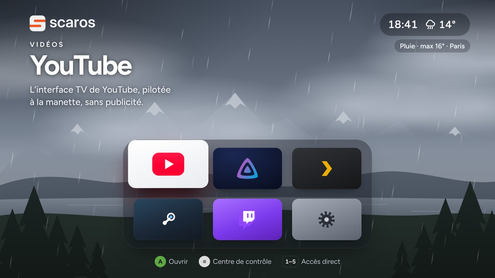
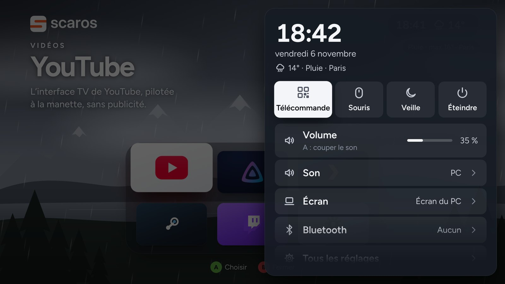
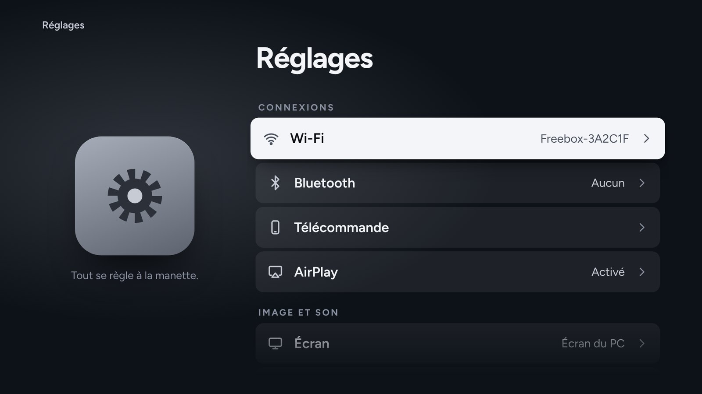
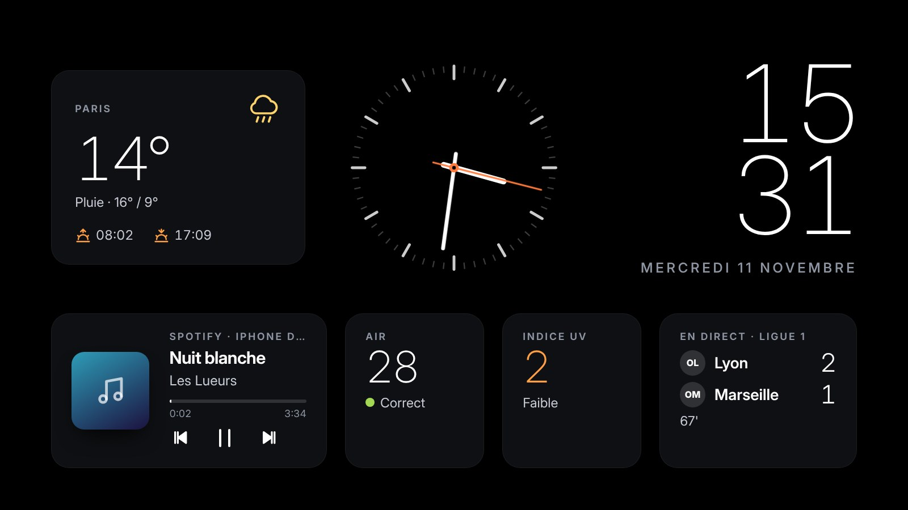
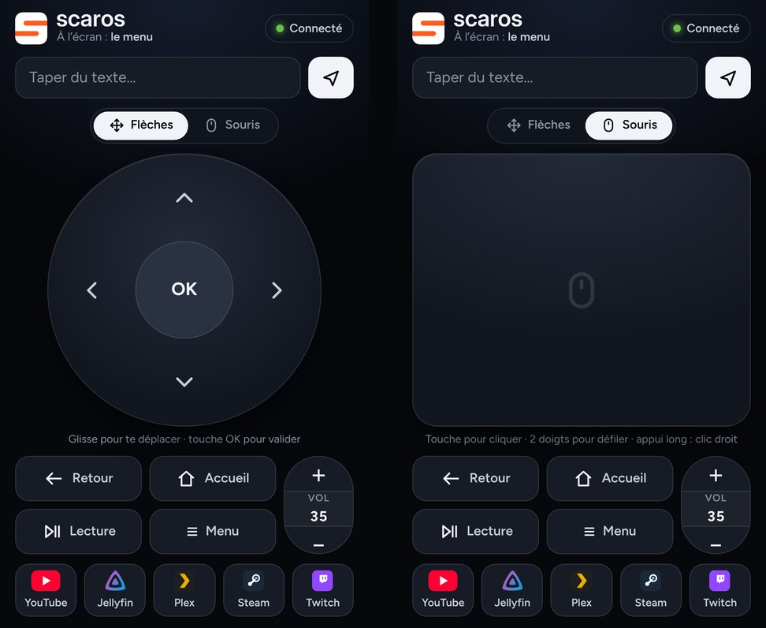

<p align="center">
  
</p>

<h1 align="center">Scaros OS</h1>

<p align="center">
  <b>Transforme un vieux PC portable en box TV, pilotée à la manette ou depuis ton téléphone.</b>
</p>

<p align="center">
  
</p>

Scaros OS installe sur un PC, même petit et vieux, un menu plein écran façon box TV. Tu l'allumes, l'animation
Scaros se lance et tu arrives directement sur tes applis : jamais de bureau, jamais de fenêtre à gérer. Branche la
télé en HDMI, l'image et le son passent dessus tout seuls.

## Ce que ça fait

- **Un accueil façon Google TV** : l'heure, la météo et les scores en haut, tes films et séries en grandes affiches
  (à reprendre, ajoutés récemment, tendances, demandes), et la bande des applis : YouTube (interface TV, sans
  publicité), Jellyfin, Plex, Steam Link et Twitch.
- **Plex et Overseerr** : « Reprendre » et « Ajoutés récemment » viennent de ton serveur Plex (connexion par code,
  sans mot de passe à taper), « Tendances » et « Mes demandes » d'Overseerr ; une affiche lance le film dans l'appli
  Plex, là où tu t'étais arrêté, ou envoie la demande à Overseerr.
- **Un App Store** : des applis qui se pilotent bien à la télé (Kodi, Stremio, Moonlight, RetroArch…) installées en un
  appui, et tes sites web ajoutés comme des applis ; depuis la télé ou le téléphone.
- **Spotify** : Scaros devient une enceinte Spotify Connect, et l'écran de veille affiche la musique en cours (même
  celle jouée sur ton téléphone), avec lecture, pause et morceau suivant.
- **Le sport** : le match de tes équipes en direct en haut de l'accueil, un onglet **Matchs** (direct, prochains
  matchs, résultats) et la fiche de chaque match (buts, cartons, remplacements, statistiques).
- **Des widgets en haut de l'accueil**, au choix : match, météo, musique en cours, air et UV.
- **Tout à la manette Xbox** (Bluetooth) : pas besoin de clavier, et le bouton Xbox ramène au menu depuis n'importe
  quelle appli.
- **Une télécommande sur ton téléphone** : une page web à garder sur l'écran d'accueil, avec pavé tactile, clavier pour
  les recherches, volume, et un **mode souris** (trackpad) pour les sites qui se pilotent mal aux flèches.
- **AirPlay** : envoie l'écran de ton iPhone, une vidéo ou des photos sur la télé.
- **La télé en HDMI** : l'image et le son basculent tout seuls ; choix Auto, Écran du PC ou Télé, en 1080p ou 720p.
- **Son Bluetooth** : casque, enceinte ou AirPods, et choix de la sortie audio.
- **Tout se règle depuis le menu** : Wi-Fi (avec un clavier à l'écran), Bluetooth, écran, son, apparence claire ou
  sombre, taille du texte, veille.
- **Un centre de contrôle par-dessus les vidéos**, et le volume ou les notifications affichés sans quitter l'appli.
- **Un écran de veille en widgets** : grande horloge, météo, qualité de l'air, indice UV, musique et match en cours, sur
  fond noir (ou le paysage animé de Scaros).
- **Personnalisable** : onglets et applis (ordre, affichées ou non), fond, couleur d'accent, horloge 12 ou 24 h,
  widgets de l'écran de veille.
- **Un diagnostic réseau intégré**, pour trouver pourquoi un téléphone n'arrive pas à joindre la box.
- **Léger** : pensé pour un Celeron et 4 Go de RAM.

## Captures

| Centre de contrôle | Réglages |
|---|---|
|  |  |
| **Écran de veille** | **Télécommande : pavé et comptes** |
|  |  |

Pour essayer le menu sans rien installer, ouvre `launcher/ui/index.html` dans Chrome : il fonctionne en maquette.

## Ce qu'il te faut

- un PC 64 bits, de préférence avec une puce Intel (testé sur un portable Celeron N4000, 4 Go de RAM, mémoire eMMC) ;
- une clé USB de 2 Go ou plus, **qui sera effacée** ;
- un autre ordinateur (sous Windows) pour préparer la clé ;
- ton Wi-Fi (nom et mot de passe), et si possible une manette Xbox et un téléphone.

Compte environ une heure, surtout des téléchargements.

> **Attention :** l'installation efface tout le disque du PC, Windows compris. Sauvegarde tes fichiers avant de
> commencer.

## Installation

### 1. Préparer la clé USB (sur ton autre ordinateur)

1. Télécharge Debian 13 « netinst » pour PC 64 bits sur <https://www.debian.org/download>
   (un fichier `debian-13.x.x-amd64-netinst.iso` d'environ 700 Mo).
2. Télécharge Rufus sur <https://rufus.ie> et lance-le.
3. Choisis ta clé USB, puis l'image ISO, puis **Démarrer**. Si Rufus demande un mode
   d'écriture, choisis **« Écrire en mode Image DD »**.

### 2. Démarrer le PC sur la clé

Le plus simple, depuis Windows sur le PC à transformer :
**Paramètres > Système > Récupération > Démarrage avancé > Redémarrer maintenant**,
puis **Utiliser un périphérique** et choisis la clé USB.

Sinon, allume le PC en tapotant la touche du menu de démarrage :
HP : Échap puis F9 · Lenovo : F12 (ou le petit bouton Novo) · Acer : F12 · Asus : Échap · Dell : F12.

### 3. Installer Debian (environ 20 minutes)

Choisis **Graphical install**, puis :

| Écran | Quoi choisir |
|---|---|
| Langue, pays, clavier | Français, France, Français |
| Réseau | ton Wi-Fi et son mot de passe |
| Nom de machine | `scaros` (domaine : laisse vide) |
| Mot de passe du superutilisateur (root) | choisis-en un et **note-le** |
| Nouvel utilisateur | par exemple `scaros`, avec un mot de passe |
| Partitionnement | **Assisté – utiliser un disque entier**, puis le disque interne (souvent « MMC/SD card », **pas la clé USB**), puis « Tout dans une seule partition », puis « Terminer » et « Oui » |
| Sélection des logiciels | **décoche** « Environnement de bureau Debian » et « GNOME », **coche** « serveur SSH » et « utilitaires usuels du système » |
| GRUB | Oui, sur le disque interne |

À la fin, retire la clé et laisse redémarrer. Tu arrives sur un écran noir avec `scaros login:`.

### 4. Installer Scaros (environ 30 minutes)

Tu peux taper les commandes directement sur le PC. Plus confortable : depuis ton autre ordinateur, ouvre un
**Terminal Windows** et connecte-toi en SSH pour copier-coller. Pour connaître l'adresse du PC, connecte-toi dessus
et tape `ip -br a` (une adresse du genre `192.168.1.42`), puis sur ton ordinateur : `ssh scaros@192.168.1.42`.

Ensuite, récupère Scaros sur le PC, au choix :

- **directement depuis GitHub** :

  ```bash
  su -
  wget -O scaros.tar.gz https://github.com/Sc4ros/Scaros-OS/archive/HEAD.tar.gz
  tar xf scaros.tar.gz
  bash Scaros-OS-*/install.sh
  ```

- **avec une clé USB** : sur ton autre ordinateur, **Code > Download ZIP** sur la page du dépôt, décompresse-le et
  copie le dossier sur une clé (renomme-le `scaros-os`). Branche la clé sur le PC, puis :

  ```bash
  su -
  mkdir -p /mnt/usb && mount /dev/sdb1 /mnt/usb    # lsblk montre le nom de la clé si ce n'est pas sdb1
  cp -r /mnt/usb/scaros-os /root/ && umount /mnt/usb
  bash /root/scaros-os/install.sh
  ```

Le script installe tout, propose d'appairer la manette, puis te dit de redémarrer :

```bash
reboot
```

### 5. À faire une seule fois au premier démarrage

- **Manette Xbox** : si tu ne l'as pas appairée pendant l'installation, va dans
  **Réglages > Manette**, puis maintiens le petit bouton d'appairage (sur le dessus,
  à côté du port USB) jusqu'à ce que le logo Xbox clignote vite.
- **Télécommande sur le téléphone** : bouton **≡** de la manette puis **Télécommande** (ou touche **Q**) :
  un grand QR code s'affiche, scanne-le avec ton téléphone (même Wi-Fi).
  **Sur iPhone, garde-la comme une appli :** ouvre-la de préférence par l'adresse `http://scaros.local:8421/remote`
  (elle ne change pas, contrairement à l'adresse IP), puis dans Safari touche **Partager > Sur l'écran d'accueil**.
  Elle s'ouvre alors en plein écran, sans barre Safari.
- **YouTube** : à la première ouverture, branche un clavier et appuie sur **Ctrl+O**
  pour ouvrir les réglages de l'appli :
  - active **Hardware Decoding** (la puce Intel décode la vidéo, le processeur respire) ;
  - dans **Filter Video Codecs**, bloque **AV1** si ta puce ne le décode pas (c'est le cas des Celeron N4000) :
    YouTube passera au VP9, très bien géré ;
  - active **Fullscreen**.

  Pour te connecter à ton compte, YouTube affiche un code à entrer sur
  <https://youtube.com/activate> depuis ton téléphone.
- **Jellyfin** : entre l'adresse de ton serveur, puis dans
  **Paramètres > Affichage > Mode d'affichage**, choisis **TV**.
- **Plex** : connecte-toi avec le code affiché, sur <https://plex.tv/link>.
- **Comptes de l'accueil** (**Réglages > Comptes**), tous facultatifs : ils remplissent l'accueil et l'écran de veille.
  - **Plex** : **Connecter Plex** affiche un code à taper sur <https://plex.tv/link>. Scaros trouve ton serveur tout
    seul. Une affiche ouvre l'appli **Plex** et lance directement le film ou l'épisode (comme « Lire sur… » depuis
    l'appli Plex du téléphone) ; si ça ne marche pas chez toi, choisis **Plex Web** dans **Réglages > Comptes > Plex**.
  - **Overseerr** (ou Jellyseerr) : sur la télécommande du téléphone, touche le bonhomme en haut, puis colle l'adresse
    d'Overseerr (`http://192.168.x.x:5055`) et sa clé API (**Overseerr > Paramètres > Général**).
  - **Spotify** (compte Premium) : **Spotify Connect** marche tout seul : dans l'appli Spotify, touche l'icône des
    appareils et choisis **Scaros**. Pour afficher aussi ce que joue ton **téléphone**, crée une appli gratuite sur
    <https://developer.spotify.com/dashboard> (**Create app**, Redirect URI `http://127.0.0.1:8421/api/spotify/callback`,
    coche **Web API**), copie son **Client ID** dans la télécommande (bonhomme > Spotify), puis **Se connecter sur la
    télé** dans **Réglages > Comptes**.
  - **Sport** (**Réglages > Sport**) : tes équipes et les compétitions suivies.
- **Steam Link** : sur ton PC de jeu, ouvre Steam, puis **Paramètres > Remote Play** et active
  Remote Play. Au premier lancement de Steam Link sur Scaros, choisis ton PC : un code
  s'affiche, entre-le dans Steam sur ton PC. Ton PC doit être allumé avec Steam ouvert.
  Si l'image saccade, baisse la qualité en 720p dans les réglages de Steam Link.
- **Twitch** : c'est SmartTwitchTV, une appli Twitch non officielle faite pour les télés (elle se pilote
  aux flèches, comme le reste). Tu peux regarder sans compte ; pour retrouver tes chaînes suivies,
  ajoute ton compte Twitch dans ses réglages. Si l'image saccade, choisis 720p dans la qualité du lecteur.
  Elle tourne dans le navigateur du PC et se met à jour toute seule : rien à installer.

## Utilisation

### Manette et clavier

| Manette Xbox | Action |
|---|---|
| Croix ou stick gauche | se déplacer |
| A | ouvrir, valider |
| B | retour |
| Bouton Xbox | retour au menu (ferme l'appli en cours) |
| LB / RB | volume − / + |
| Y | lecture / pause |
| ≡ (Menu) | centre de contrôle : volume, son, écran, Bluetooth, veille. Pendant une vidéo, l'appli reste ouverte derrière : B pour y revenir |

Au clavier : flèches, Entrée, Échap ; la **touche Windows** ramène au menu ; **M** ouvre le centre de contrôle ;
**1 à 5** ouvrent directement YouTube, Jellyfin, Plex, Steam Link et Twitch ; **+ / −** pour le volume, **0** coupe le son.

**Dans Steam Link**, la manette sert au jeu : tous ses boutons vont au jeu, et un appui court sur
le bouton Xbox ouvre le menu de Steam. Pour revenir au menu Scaros, **maintiens le bouton Xbox**
une seconde.

### Télécommande du téléphone

Glisse sur le pavé pour te déplacer, touche OK pour valider. Sous le pavé, les touches sont rangées comme sur une
télécommande Apple TV : **Retour**, **Accueil**, **Lecture** et **Menu** à gauche, et le **volume** en bascule verticale
à droite (**+** en haut, **−** en bas, reste appuyé pour aller vite ; touche le chiffre du milieu pour couper ou
remettre le son). En haut, elle affiche ce qui est à l'écran, et le champ « Taper du texte » envoie tes recherches
à l'appli ouverte.

### Mode souris

Pour une appli ou un site qui se pilote mal aux flèches : sur la télécommande, touche **Souris** au-dessus du pavé.
Le pavé devient un trackpad : glisse un doigt pour déplacer le curseur (plus tu vas vite, plus il va loin),
**touche** pour cliquer, **appui long** ou **touche à deux doigts** pour le clic droit, **glisse à deux doigts** pour
faire défiler. **Flèches** revient au pavé habituel.

À la manette, active-le avec la tuile **Souris** du centre de contrôle (**≡**), ou dans **Réglages > Manette** :
par-dessus une appli, le **stick gauche** déplace le curseur, **A** clique (maintenu : glisser), **X** fait un clic
droit et le **stick droit** fait défiler ; B, la croix, LB/RB, ≡ et le bouton Xbox gardent leur rôle. Dans le menu de
Scaros, la manette garde les flèches. Le mode est le même pour la télécommande et la manette : l'activer d'un côté
l'active de l'autre.

### Bluetooth et son

**Réglages > Bluetooth > Rechercher des appareils**, mets l'appareil en mode appairage, puis choisis-le dans la
liste : le son passe dessus tout seul. Les fois suivantes, plus besoin du mode appairage : choisis-le dans
**Mes appareils** et il se reconnecte (la manette, elle, se reconnecte seule quand tu l'allumes). Les appareils restent
mémorisés après un redémarrage. Pour des AirPods, ouvre le boîtier près du PC ; s'ils sont pris par ton téléphone,
déconnecte-les de celui-ci. N'utilise **Oublier cet appareil** que s'il ne se connecte plus du tout.

Dans **Réglages > Son**, tu choisis où sort le son : **Auto** (l'appareil Bluetooth s'il est connecté, sinon l'écran
utilisé), **Télé**, **Haut-parleurs du PC** ou **Appareil Bluetooth**. Pendant une vidéo, le volume, le son coupé, la
manette ou les AirPods qui se connectent s'affichent en haut de l'écran, sans interrompre l'appli.

### AirPlay (iPhone, iPad, Mac)

Sur l'iPhone, ouvre le **Centre de contrôle**, touche **Recopie de l'écran** puis choisis **Scaros** (même Wi-Fi).
Le bouton AirPlay d'une appli (vidéo, photos, musique) marche aussi. **B** ou le **bouton Xbox** arrête la recopie ;
**≡** ouvre le centre de contrôle par-dessus. **Réglages > AirPlay** pour le désactiver.

### Télé

Branche le câble HDMI : l'image et le son passent sur la télé. Tu peux fermer l'écran du portable, il ne se met pas
en veille. Le choix Auto / Écran du PC / Télé est dans **Réglages > Écran**. L'image est envoyée en **1080p**, même sur
une télé 4K : un petit PC resterait poussif en 4K. Si les vidéos saccadent, passe en **720p** au même endroit.

### Accueil

En haut à gauche l'heure et la date ; à droite, de grandes cartes (**widgets**) : le match de ton équipe (logos, score,
minute), la météo, la musique en cours, l'air et les UV. Dessous, les onglets **Reprendre**, **Ajoutés récemment**,
**Tendances**, **Mes demandes** et **Matchs**, et quatre boutons ronds (centre de contrôle, AirPlay, Wi-Fi, Réglages).
Au milieu, les affiches de l'onglet choisi ; en bas, la bande des applis. **Haut** et **bas** passent d'une rangée à
l'autre (tout en haut : les widgets ; OK sur le match ouvre sa fiche, OK sur la musique met en pause), **gauche** et
**droite** avancent dans la rangée. Le fond reprend l'affiche choisie, floutée. Tant qu'un compte n'est pas relié,
l'onglet le dit et OK ouvre **Réglages > Comptes**.

### Matchs

L'onglet **Matchs** montre les matchs des compétitions suivies en grandes cartes : en direct d'abord, puis les prochains
(tes équipes en tête), puis les résultats de la veille. OK ouvre la **fiche du match** : score, buts, cartons et
remplacements minute par minute, statistiques (possession, tirs, corners…), mise à jour pendant le direct. Les données
viennent d'ESPN, sans compte.

### App Store

La tuile **App Store**, au bout de la bande des applis (ou **Réglages > App Store**), installe en un appui des applis
de Flathub qui se pilotent bien à la télé : Kodi, Stremio, FreeTube, Grayjay, VLC, Plexamp, Spotify, Shortwave,
Moonlight, Greenlight, chiaki-ng, RetroArch, PPSSPP et Pegasus. L'appli arrive au bout de la bande ; **Gérer** la
désinstalle. **Manette** : l'appli lit la manette elle-même (maintiens le bouton Xbox pour revenir au menu) ;
**Souris** : elle se pilote mieux avec le mode souris. **Ajouter un site web** en fait une appli (un nom, une adresse),
ouverte en plein écran. Tout se fait aussi depuis la télécommande du téléphone (le sac en haut). Les touches 1 à 9
ouvrent les applis dans l'ordre de la bande.

### Personnaliser

- **Réglages > Accueil** : les **widgets du haut** (lesquels et dans quel ordre), les onglets affichés et leur ordre, les applis de la bande et leur ordre (OK affiche ou
  masque, gauche et droite déplacent), le fond (**Affiche** du programme choisi, **Paysage** animé qui suit la météo et
  l'heure, ou **Uni**, le plus léger) et la couleur d'accent.
- **Réglages > Affichage** : sombre, clair ou automatique pour les réglages, la taille du texte, l'horloge sur 24 h ou
  12 h, et la veille automatique.
- **Réglages > Fond et météo** : le paysage (temps réel, nuit étoilée, aurore, pluie, neige) et la ville de la météo,
  devinée au premier démarrage ; météo et qualité de l'air viennent d'Open-Meteo (gratuit, sans compte).
- **Réglages > Sport** : tes équipes passent en premier (en direct, du jour, sinon le prochain match), puis les autres
  matchs en cours des compétitions suivies. Les scores viennent d'ESPN, sans compte.

### Écran de veille

Après 5 minutes sans toucher au menu. Le style **Widgets**, sur fond noir, montre une grande horloge à aiguilles,
l'heure en chiffres fins, la météo (lever et coucher du soleil), la qualité de l'air, l'indice UV, la **musique en
cours** (pochette, progression, ◀◀ ⏯ ▶▶ : Spotify, ou la pochette de la musique envoyée en AirPlay) et le match de ton
équipe ; l'ensemble glisse un peu chaque minute pour ne pas marquer la télé. **Lecture** (Y à la manette) met la
musique en pause sans fermer l'écran de veille ; une autre touche le ferme sans rien lancer. Le style **Paysages**
montre le paysage de Scaros en plein écran. **Réglages > Écran de veille** : activé ou non, style, widgets, délai
(2, 5, 10 ou 15 minutes), et **Voir l'écran de veille**. **Veille** (centre de contrôle, ou **Réglages > Alimentation**)
et la veille automatique l'affichent aussi. Il ne passe jamais par-dessus une appli.

## Mettre à jour

Scaros OS ne se met **pas** à jour tout seul : il n'y a pas de bouton de mise à jour dans le menu, et il ne cherche
jamais de nouvelle version sur internet. Pour en installer une :

1. Récupère le dossier de la nouvelle version sur le PC, comme à l'étape 4 de l'installation (GitHub ou clé USB).
2. Lance son script de mise à jour :

   ```bash
   su -
   bash /root/scaros-os/update.sh      # le chemin du dossier de la NOUVELLE version
   ```

Le script installe les fichiers de ce dossier (et les paquets ajoutés depuis, s'il y en a), puis relance l'écran ;
le menu affiche « Scaros est à jour ». Les applis, les réglages et tes appareils Bluetooth sont gardés.
Pour tout réinstaller (paquets, applis), relance plutôt `install.sh` depuis le même dossier.

Les applis (YouTube, Jellyfin, Plex, Steam Link) se mettent à jour à part : **Réglages > Applis > Mettre à jour les
applis**.

## Si quelque chose coince

- **Console de secours :** Ctrl+Alt+F2, puis connecte-toi. Ctrl+Alt+F1 pour revenir à Scaros.
- **Journaux :** dans `~/.local/state/scaros/` (`scaros.log`, `chromium.log`, `airplay.log`, `spotifyd.log`, `osd.log`,
  et un fichier par appli, par exemple `youtube.log`). Joins-les si tu demandes de l'aide.
- **Démarrer sans Scaros** (pour réparer) : `touch ~/.scaros-off` puis `reboot`.
  Pour le remettre : `rm ~/.scaros-off`.
- **Changer de Wi-Fi :** **Réglages > Wi-Fi**, choisis le réseau et tape le mot de passe avec le clavier à l'écran
  (ou un vrai clavier, ou la télécommande du téléphone). En secours : console, `su -` puis `nmtui`.
- **Vérifier le décodage vidéo :** `vainfo` doit lister VP9 et HEVC.
- **Le téléphone n'arrive pas à joindre Scaros (télécommande ou AirPlay) : lance le diagnostic réseau.**
  **Réglages > Wi-Fi > Diagnostic réseau** (aussi sur l'écran Télécommande et dans AirPlay). Scaros vérifie sa
  connexion (économie d'énergie Wi-Fi, adresse utilisée par un autre appareil, pare-feu, box), puis écoute 30 secondes
  pendant que tu ouvres la télécommande puis la **Recopie de l'écran** sur le téléphone : il voit si les demandes
  arrivent jusqu'à lui et dit où elles se perdent. Pour copier le rapport, ouvre `http://<adresse de Scaros>:8421/diag`
  sur un ordinateur. À la main : `su -` puis `scaros-diag`. Si « rien n'est arrivé », c'est le réseau entre le
  téléphone et le PC : souvent un CPL ou un répéteur Wi-Fi qui isole les appareils. Le plus sûr est alors de brancher
  le PC par câble.
- **CPL ou répéteur Wi-Fi :** mets Scaros sur le Wi-Fi **2,4 GHz** du boîtier (souvent le même nom, sans « _5G »).
  Vu en vrai avec un CPL : sur son 5 GHz, l'iPhone voyait Scaros mais ne pouvait ni ouvrir la télécommande ni lancer
  AirPlay ; sur son 2,4 GHz, tout marche. Le diagnostic réseau le signale.
- **La télécommande ne s'ouvre pas (« Ce site est inaccessible ») :** sur iPhone, ouvre-la dans **Safari**.
  Les autres navigateurs (Brave, Chrome, Firefox…) ne peuvent joindre les appareils de la maison qu'avec l'accès
  « Réseau local » : **Réglages > Confidentialité et sécurité > Réseau local**, active ton navigateur. Attention,
  l'appareil photo ouvre les QR codes dans le navigateur par défaut.
- **Toujours rien :** ouvre **≡ > Télécommande** sur la télé et scanne le QR code : il donne toujours l'adresse
  actuelle du PC. L'écran indique aussi le Wi-Fi de Scaros : le téléphone doit être sur le même (pas le réseau
  invité). Si le QR code marche mais pas l'icône de l'écran d'accueil, c'est que l'adresse du PC a changé : supprime
  l'icône et ajoute-la de nouveau depuis la page ouverte par le QR code. Pour qu'elle ne change plus, réserve
  l'adresse du PC dans les réglages de la box (« bail DHCP statique »).
- **Scaros n'apparaît pas dans la recopie de l'écran de l'iPhone (alors que la télécommande marche) :** regarde
  **Réglages > AirPlay**, qui dit ce qui coince. « Prêt » veut dire que Scaros s'annonce bien sur le Wi-Fi. La
  télécommande passe par une connexion directe, mais l'iPhone trouve AirPlay grâce à des annonces envoyées à tout le
  réseau (Bonjour), que beaucoup de CPL et de répéteurs filtrent, surtout entre leurs bandes 2,4 et 5 GHz. Donc :
  1. mets l'iPhone sur le même Wi-Fi **et la même bande** que Scaros (le 2,4 GHz du même boîtier) ;
  2. sur l'iPhone, coupe puis rallume le Wi-Fi (il oublie les appareils qu'il avait en mémoire) ;
  3. toujours rien : lance le diagnostic réseau et, pendant l'écoute, ouvre la télécommande puis **Recopie de
     l'écran** sur l'iPhone. La partie « AirPlay » du rapport dit si la recherche de l'iPhone arrive jusqu'à
     Scaros, si Scaros lui répond, ou si le réseau bloque toutes les annonces ;
  4. dans les réglages du CPL ou de la box, désactive l'isolation des appareils et le filtrage multicast (IGMP).

  Sinon, « Redémarrer AirPlay », et le journal est dans `~/.local/state/scaros/airplay.log`.
- **Les affiches ne s'affichent pas :** **Réglages > Comptes** dit ce qui coince (serveur Plex éteint, clé Overseerr
  refusée…). Si le serveur Plex a changé d'adresse, **Reconnecter Plex** ; la télécommande permet aussi de taper
  l'adresse et le jeton à la main.
- **Scaros n'apparaît pas dans l'appli Spotify :** il faut un compte Premium et le même Wi-Fi ; **Réglages > Comptes >
  Spotify Connect** doit être activé, sinon regarde `spotifyd.log`.
- **Une affiche ouvre Plex mais pas le film :** Plex HTPC doit accepter les ordres de lecture (comme quand tu
  lances un film depuis l'appli Plex du téléphone). Sinon, choisis **Plex Web** dans **Réglages > Comptes > Plex**.
- **Une appli de l'App Store ne s'installe pas :** il faut internet et de la place sur le disque (certaines
  applis téléchargent plusieurs centaines de Mo la première fois) ; le détail est dans `scaros.log`.
- **Une appli met du temps à s'ouvrir :** la première ouverture peut prendre jusqu'à une minute sur un petit PC.
  Si elle se ferme aussitôt, Scaros la relance une fois tout seul.

## Limites connues

- **Pas de Netflix, Disney+ ni Prime Video** : sous Linux, leurs protections brident la qualité, et leurs sites se
  pilotent mal à la manette.
- **La télé ne s'allume pas avec Scaros** : les PC portables n'ont pas de HDMI-CEC (il faudrait un adaptateur USB).
- **Pas de 4K** : l'image part en 1080p au plus, pour rester fluide sur un petit processeur.
- **AirPlay** passe par UxPlay, un logiciel libre non officiel : la fluidité dépend du Wi-Fi, et une future version
  d'iOS pourrait le casser.
- **D'un PC à l'autre**, les noms des sorties vidéo changent : sur un autre modèle que celui testé, vérifie la
  bascule vers la télé au premier essai.

## Comment c'est fait

```
scaros-os/
├── install.sh              installe tout sur un Debian 13 minimal
├── update.sh               mise à jour à la main (à lancer depuis le dossier d'une nouvelle version)
├── LICENSE                 licence GNU GPL version 3
├── docs/                   captures d'écran de ce README
├── launcher/
│   ├── scaros.py           serveur local : applis, écrans, son, Bluetooth, manette, télécommande, AirPlay, météo
│   ├── media.py            accueil et veille : Plex, Overseerr, Spotify, pochette AirPlay, scores (ESPN)
│   ├── store.py            le catalogue de l'App Store (applis Flathub qui se pilotent bien à la télé)
│   ├── osd.py              volume et notifications affichés par-dessus les applis
│   ├── apps.json           les applis du menu et la commande qui les lance
│   └── ui/
│       ├── index.html      le menu (marche aussi seul, en maquette)
│       ├── remote.html     la télécommande téléphone (http://<adresse du PC>:8421/remote)
│       ├── icons/          icônes de la télécommande
│       └── fonts/          police Inter (licence OFL)
└── system/
    ├── session.sh          session graphique : Openbox, serveur, menu plein écran
    ├── scaros-diag.sh      diagnostic réseau (commande scaros-diag, lancé aussi depuis le menu)
    ├── openbox/rc.xml      toutes les fenêtres en plein écran
    └── plymouth/scaros/    écran de démarrage
```

Au démarrage : GRUB (masqué), écran Plymouth Scaros, connexion automatique sur le compte, puis `startx` lance
`session.sh`. Le menu tourne dans Chromium en mode kiosque, servi par `scaros.py`, un petit serveur Python. Les applis sont des
Flatpak de Flathub : VacuumTube (`rocks.shy.VacuumTube`) pour l'interface TV de YouTube, Jellyfin Desktop
(`org.jellyfin.JellyfinDesktop`), Plex HTPC (`tv.plex.PlexHTPC`) et Steam Link (`com.valvesoftware.SteamLink`).
Twitch est l'appli web SmartTwitchTV, ouverte dans un Chromium plein écran avec son propre profil ; Scaros vérifie que
son adresse répond avant de l'ouvrir.

`scaros.py` réserve la manette et la transforme en touches clavier, pour qu'elle marche pareil dans toutes les applis.
En mode souris, il crée une souris virtuelle (uinput, avec repli sur `xdotool`) ; la télécommande lui envoie ses gestes
par une connexion WebSocket gardée ouverte (`/api/mouse`).

Pour tester sans PC dédié : `python3 launcher/scaros.py --dry-run`, puis ouvre <http://localhost:8421>. Dans ce mode,
rien n'est lancé pour de vrai, et la touche H simule le branchement de la télé.

## Crédits

Scaros OS assemble et pilote des logiciels libres ou gratuits, sans les modifier :
[Debian](https://www.debian.org), Openbox, Chromium, PipeWire, BlueZ, Plymouth,
[VacuumTube](https://flathub.org/apps/rocks.shy.VacuumTube), [Jellyfin](https://jellyfin.org),
[Plex HTPC](https://flathub.org/apps/tv.plex.PlexHTPC), [Steam Link](https://flathub.org/apps/com.valvesoftware.SteamLink),
[SmartTwitchTV](https://github.com/fgl27/SmartTwitchTV), [UxPlay](https://github.com/FDH2/UxPlay),
[spotifyd](https://github.com/Spotifyd/spotifyd), la police [Inter](https://rsms.me/inter/) (licence OFL, voir
`launcher/ui/fonts/OFL.txt`), la météo et la qualité de l'air d'[Open-Meteo](https://open-meteo.com) ; les affiches
des tendances viennent de [TMDB](https://www.themoviedb.org) via Overseerr, et les scores d'ESPN.

Les noms et logos de YouTube, Jellyfin, Plex, Steam, Twitch, Spotify, Overseerr et ESPN appartiennent à leurs propriétaires. Scaros OS n'est
affilié à aucun de ces services.

## Licence

Scaros OS — Copyright © 2026 Sc4ros.

Ce programme est un logiciel libre : tu peux le redistribuer et le modifier selon les termes de la
[licence publique générale GNU, version 3](LICENSE). Il est fourni sans aucune garantie.
